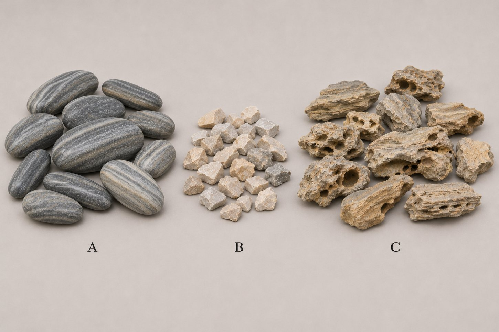
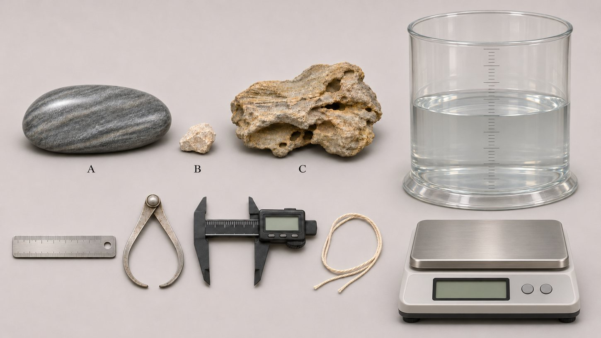

# How Uniform Are These Rocks?

A model-eliciting activity by Randall Young for CORE 10. Students turn an intentionally vague question into a measurement rule that another team can use. **Inquiry comes first. Python does the arithmetic after students decide what to compare and why.**



## Start with the rocks

Show one specimen of each type or place three labelled piles on the bench: A, polished gray oblong metamorphic pebbles; B, smaller limestone gravel; C, irregular sedimentary fragments with pits and passages. The images are prototypes, not measured specimens or evidence for how C’s tunnels formed.

Ask only **“How uniform are these rocks?”** Collect initial interpretations before handing out formulas or this program. Ask students to point to what they compared. The museum client later needs a reusable rule and a reason to trust it on unfamiliar rocks.

- **Within one rock.** Are regions alike in a named property, such as missing volume fraction? Choose an axis, a partition and a boundary. Clay or appropriate section data are needed for regional volumes; cylinder displacement cannot locate cavities.
- **Within one pile.** Do different rocks have similar values for the same property? Number the rocks and measure all of them, or draw a sample without choosing the most striking ones.
- **Between piles.** Are their typical values or distributions similar? Report what each pile contains and how it was sampled. The starter program compares pile means, not entire distributions. Similar means can hide different spreads.
- **Repeated readings are not extra rocks.** Have two operators independently measure some of the same specimens and retain both readings. If the repeat disagreement approaches the difference between rocks, improve the measurement before ranking them.

## Set up the measurement bench



- **Ruler, manual outside caliper, budget wide-opening digital caliper, and nonstretch string.** Measure three perpendicular full spans and agree on orientation. Zero the digital caliper. Transfer manual-caliper openings to the ruler. For string girth, define the plane and how the string crosses pits and gaps. Girth is not a diameter or a surface area.
- **Wide-mouth graduated cylinder or calibrated straight-sided measuring vessel.** Dry-fit the largest rock with enough room for a loop or tongs. Leave enough water to cover it fully and enough headroom that the final reading stays below the highest usable mark. Test all specimens, not just the prototypes. Measure one rock at a time. A wide vessel fits C but may not resolve B; use a narrower graduated cylinder for B or a suitable balance-based displacement method.
- **Digital balance.** Use enough capacity for the heaviest dry specimen and fine enough resolution for the gravel. Zero it, weigh the dry rock, and record grams before wetting. If using a vessel on the balance for buoyancy-based displacement, its water and vessel must also fit the balance capacity. This is a separate setup from ordinary dry-mass weighing.
- **Graduated displacement.** Set the vessel level. Read the bottom of the water meniscus at eye level before and after full immersion. Use a fine suspension with negligible displacement, or correct for the portion submerged. Avoid splashing and note bubbles, reading drift, smallest graduation and wetting time. The difference in mL is volume in cm³. If C is friable or would be damaged by water, keep it dry and use a replica or section data instead.
- **Density.** Divide dry mass in grams by displaced volume in cm³. For a dense nonabsorbing clast, this estimates its specimen density. If water enters open passages, report the ratio as **dry mass divided by water-accessible-protocol displacement**. It is not automatically envelope bulk density or mineral grain density. Open water-filled passages are excluded from displacement, and trapped air can make the displaced volume larger. Never mix these conventions silently.

**Inquiry safeguard.** Leave the cylinder and balance available, but do not require every group to use every instrument. Ask what question a new measurement would settle. A useful prediction to test is whether ellipsoid volume, πLWT/6, works better for A than C when compared against compatible displacement.

## Give AI a specification, not the question

Before asking AI to write or modify code, fill in and submit this prompt:

> Our question is ____. One observation is ____. We will measure ____ in ____ units using ____. For repeated readings, do ____. We define greater uniformity as ____. Use the following rule and show the intermediate values ____. Treat missing values as missing, not zero. A result would be usable for our decision if ____. Use Python and CSV with no third-party packages. Label shape proxies and boundary conventions, and write tests using our predicted answers for these two contrasting examples: ____ and ____.

Students should predict a result by hand, inspect the AI-generated code for unit conversions and aggregation, run the tests, then exchange the rule and program with another team. Require the other team to apply the rule to a held-out specimen or pile without coaching. A rule can be repeatable yet answer the wrong question. Check both. Do not upload student identifiers or raw student research records to AI or to the public repository.

## Run the Python starter

Python 3.10 or later. No packages to install. Use a terminal in this folder. On Windows, substitute `py` if `python` is not recognized.

```text
python rock_lab.py capture my_rocks.csv
python rock_lab.py report example_rocks.csv --scope within-pile --metric axis_ratio --question "How similar are rocks in each pile in shortest-to-longest axis ratio?" --output per_rock.csv
python rock_lab.py report example_rocks.csv --scope between-piles --metric density_g_cm3 --question "Do the piles have similar mean density under the same displacement convention?"
python rock_lab.py report example_rocks.csv --regions example_regions.csv --scope within --metric void_sd_pp --question "Is missing volume evenly distributed within each model?"
python rock_lab.py report example_rocks.csv --scope within-pile --metric wadell --question "How much does matched-boundary sphericity vary within a pile?"
python -m unittest -v
```

All example numbers are **synthetic**. The Wadell fixture is an ideal sphere with independently specified area and volume, not a measurement of prototype A.

| Input or output | Meaning |
| --- | --- |
| Capture or `blank_rocks.csv` | One row per rock per repeat ID. Enter mm, g and mL. Blank means not measured. Document the instrument, operator, axis, immersion conditions, and sampling choice in notes or a separate log. |
| `axis_ratio` | Thickness divided by length. This is a caliper-based shape proxy, **not** Wadell sphericity. A cube can score 1 on the axis ratio. |
| `wadell` | Area of an equal-volume sphere divided by actual surface area, `(36*pi*V**2)**(1/3)/A`. Enter measured shape volume in cm³ and area in cm² for the **same** boundary, plus its label. A calibrated 3-D mesh or CT can provide those values. The program leaves this metric absent if those inputs are missing. |
| `blank_regions.csv` | One row per rock/region/scheme. Use the same orientation and partition rule across compared rocks and label it. Provide hull and occupied volume. The program reports the hull-volume-weighted mean missing percentage and regional SD. Equal hull volumes yield ordinary descriptive SD. |
| `displacement_cm3` and `density_g_cm3` | Use `direct` for the stable displacement of a nonabsorbing or effectively nonporous clast. Use `water-accessible` when connected cavities fill, and record the immersion protocol. The starter reports these conventions separately. |
| Report and optional CSV | Mean repeated values per rock under each convention. A within-pile report shows n, mean, range, and descriptive SD across rocks. A between-pile report compares equally weighted pile means. No inference beyond the measured specimens is implied. |

### Instructor counterexample

The region fixture includes two rocks with the same 10% mean missing volume. A01 has 10% missing in each of four equal-envelope regions and zero regional SD. C01 has 0%, 0%, 0%, 40% and a regional SD of about 17.32 percentage points. Ask the team to decide **before seeing the answer** whether its model should tie or separate them. Use a sphere and smooth ellipsoid to challenge a shape metric. Finish with another team's uncoached handoff.

## Background and materials

- [Executive summary](EXECUTIVE_SUMMARY.md) — what the activity, equipment, software, and research proposal accomplish.
- [Committee research proposal, edition 1.1](Uniformity_Through_Inquiry_Research_Proposal_v1_1.pdf) — now includes Appendix C. The [original 15-page edition](Uniformity_Through_Inquiry_Research_Proposal.pdf) is retained unchanged.
- [Appendix C: Hakon Wadell and the measurement of rock shape](APPENDIX_C_WADELL.md) — historical context, the portrait source, and the distinction between roundness, sphericity, and the classroom proxy.
- [Three prototype specimens](illustrations/three-rocks.jpg)
- [Three populations](illustrations/rock-populations.jpg)
- [Dimensional tools](illustrations/dimensional-tools.jpg)
- [Cylinder-only bench](illustrations/cylinder-bench.jpg)
- [Complete bench with cylinder and balance](illustrations/full-bench.jpg)

The generated illustrations are not calibrated images for measurement. Use the physical specimens and instruments for data.
